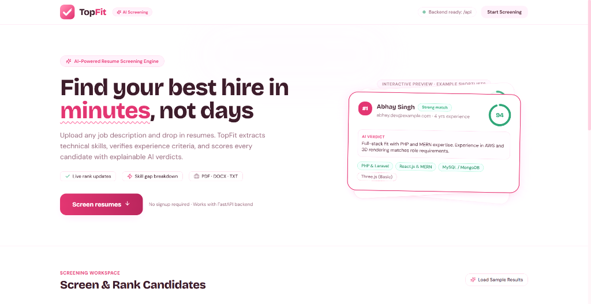
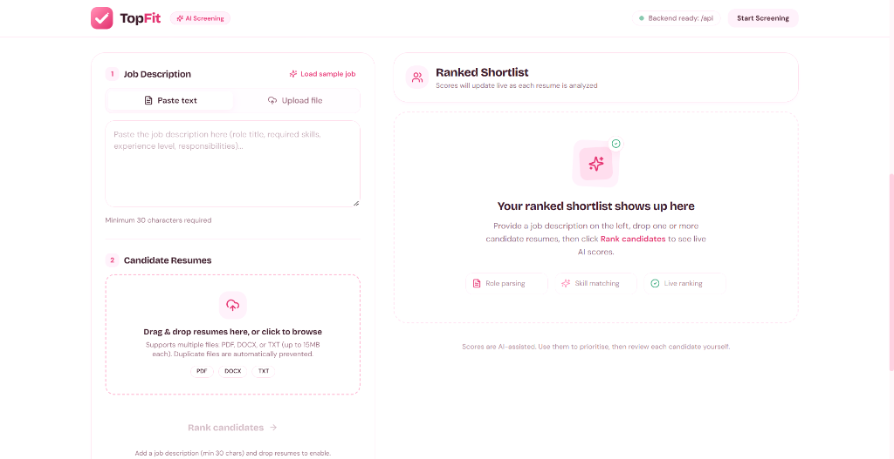

<div align="center">

# 🎯 TopFit
### AI-Powered Resume Screening & Intelligent Candidate Shortlisting

[](https://react.dev/)
[](https://www.typescriptlang.org/)
[](https://vitejs.dev/)
[](https://tailwindcss.com/)
[](https://fastapi.tiangolo.com/)
[](https://python.org)
[](https://groq.com/)
[](LICENSE)

<p align="center">
  <b>Find your best hire in minutes, not days.</b><br>
  TopFit automatically parses job criteria, extracts technical competencies, evaluates experience milestones, and scores candidate resumes with explainable AI verdicts.
</p>

</div>

---

## 📸 Application Preview

### 1. Landing & Interactive Candidate Preview
> Modern hero landing with instant role preview, animated match rings, and match labels.

<p align="center">
  
</p>

### 2. Screening Workspace & Ranked Shortlist
> Dual-pane workspace: input job descriptions, batch-upload resumes (PDF, DOCX, TXT), and inspect real-time AI ranked shortlists with skill gap breakdowns.

<p align="center">
  
</p>

---

## ✨ Key Features

- **⚡ Real-Time AI Scoring & Live Ranking:**
  Submits resumes sequentially with a live progress bar. Candidates are dynamically inserted and re-sorted in real time as each evaluation completes.
- **🔍 Explainable AI Verdicts:**
  Each candidate card provides a transparent recruiter summary highlighting core competencies, notable achievements, and potential red flags.
- **🧩 Skill Gap Breakdown:**
  Instantly highlights matched skills (*green tags*) alongside missing prerequisites (*dashed pink badges*).
- **📂 Multi-Format Resume Ingestion:**
  Accepts PDF, DOCX, and TXT files up to 15MB each, featuring automatic duplicate prevention and chip-based file management.
- **🛡️ Fault-Tolerant Batch Pipeline:**
  If an unreadable or corrupt document is uploaded, it generates an isolated error report while remaining resumes continue scoring seamlessly.
- **🎛️ Interactive Thresholds & CSV Export:**
  Filter candidates on-the-fly using the minimum score slider and experience requirement toggle. Export the complete ranked shortlist to UTF-8 BOM CSV with a single click.
- **🌸 Modern Light-Pink Design System:**
  Crafted with a bespoke palette (`blush`, `petal`, `rose`, `berry`), smooth micro-interactions, accessible contrast, and zero layout shift.

---

## 🛠️ Architecture & Tech Stack

```text
┌────────────────────────────────────────────────────────┐
│                   TopFit Frontend                      │
│     React 18 + TypeScript + Vite + Tailwind CSS        │
│    Radix UI Primitives + Framer Motion + Lucide        │
└───────────────────────────┬────────────────────────────┘
                            │  /api/job & /api/score
                            ▼
┌────────────────────────────────────────────────────────┐
│                   FastAPI Backend                      │
│      Uvicorn Server + Pydantic v2 Validation           │
│      PyPDF & python-docx Document Parsers              │
└───────────────────────────┬────────────────────────────┘
                            │  High-Speed Inference
                            ▼
┌────────────────────────────────────────────────────────┐
│             Groq Llama-3 AI Engine                     │
│    Semantic Extraction & Explainable Verdict Gen       │
└────────────────────────────────────────────────────────┘
```

| Area | Technologies |
| :--- | :--- |
| **Frontend** | React 18, Vite 5, TypeScript 5, Tailwind CSS, Radix UI Primitives |
| **Animation & UX** | Framer Motion, Sonner Toasts, SVG Animated Circular Rings |
| **Backend** | Python 3.10+, FastAPI, Uvicorn, Pydantic |
| **Document Parsing** | PyPDF, python-docx |
| **AI / LLM Inference** | Groq Cloud API (Llama 3 70B/8B models) |

---

## 🚀 Getting Started

### Prerequisites
- **Node.js**: `v18.0.0` or higher (tested on Node v20/v22)
- **Python**: `3.10` or higher
- **Groq API Key**: Obtain a free key from [console.groq.com](https://console.groq.com)

---

### 1. Backend Setup (FastAPI)

1. Open your terminal and navigate to the backend directory:
   ```bash
   cd backend
   ```

2. Create and activate a Python virtual environment:
   ```bash
   # Windows (PowerShell)
   python -m venv venv
   .\venv\Scripts\activate

   # macOS / Linux
   python3 -m venv venv
   source venv/bin/activate
   ```

3. Install required Python packages:
   ```bash
   pip install -r requirements.txt
   ```

4. Configure your environment variables:
   ```bash
   cp .env.example .env
   ```
   Open `backend/.env` and insert your credentials:
   ```env
   GROQ_API_KEY=gsk_your_groq_api_key_here
   QDRANT_URL=your_qdrant_url_optional
   QDRANT_API_KEY=your_qdrant_key_optional
   ```

5. Run the FastAPI development server:
   ```bash
   uvicorn main:app --reload --port 8000
   ```
   - API endpoints: `http://localhost:8000`
   - Interactive Swagger Docs: `http://localhost:8000/docs`

---

### 2. Frontend Setup (React + Vite)

1. Open a new terminal tab in the root project directory:
   ```bash
   npm install
   ```

2. Start the Vite development server:
   ```bash
   npm run dev
   ```

3. Open your browser at:
   ```
   http://localhost:5173
   ```
   *Vite is configured to automatically proxy `/api/*` calls to the FastAPI backend at `http://localhost:8000`.*

---

## 📡 API Reference

### `POST /api/job`
Parses raw job descriptions into structured requirements and extracted criteria.

**Request Payload:**
```json
{
  "description": "Full-Stack Developer with 3+ years experience in React, TypeScript, and FastAPI..."
}
```

**Response (200 OK):**
```json
{
  "job_id": "job_9f8b2a1c",
  "title": "Full-Stack Developer",
  "required_skills": ["React", "TypeScript", "FastAPI"],
  "preferred_skills": ["Docker", "Tailwind CSS"],
  "min_experience_years": 3
}
```

---

### `POST /api/score`
Evaluates a single candidate resume against an active job role.

**Request (Multipart Form):**
- `job_id`: string
- `file`: Resume document (`.pdf`, `.docx`, or `.txt`)

**Response (200 OK):**
```json
{
  "candidate_name": "Abhay Singh",
  "email": "abhay.dev@example.com",
  "score": 94,
  "match_level": "strong",
  "verdict": "Full-stack fit with PHP and MERN expertise. Experience in AWS and 3D rendering matches role requirements.",
  "matched_skills": ["React.js", "TypeScript", "FastAPI"],
  "missing_skills": ["Docker"],
  "experience_years": 4,
  "meets_experience": true
}
```

---

## 🎨 Design Tokens

TopFit features a custom theme built with CSS variables and Tailwind tokens:

| Token | Hex | Role |
| :--- | :--- | :--- |
| `blush` | `#fff6f9` | Canvas background |
| `petal` | `#ffe4ed` | Card surfaces & light accents |
| `petal-dark` | `#ffd1e1` | Hover states & chip badges |
| `line` | `#f7cfdd` | Subtle borders and dividers |
| `rose` | `#f28fb0` | Soft highlight accents |
| `berry` | `#d6336c` | Primary brand color & action buttons |
| `berry-dark`| `#b02458` | Active button presses |
| `plum` | `#3a1b29` | High-contrast body typography |
| `success` | `#2f9e72` | Positive matches (score ≥ 75) |

---

## 📁 Repository Structure

```text
TopFit/
├── docs/
│   └── images/                  # High-resolution screenshots for README
│       ├── hero-preview.png
│       └── screening-workspace.png
├── public/                      # Static assets & SVG icons
├── src/
│   ├── components/              # Modular React UI components
│   │   ├── CandidateCard.tsx    # Candidate card with score ring & verdict
│   │   ├── JobInput.tsx         # Job description input & file parser
│   │   ├── ResumeDropzone.tsx   # Drag-and-drop batch resume upload
│   │   ├── ResultsPanel.tsx     # Ranked shortlist, filters & CSV exporter
│   │   ├── ScoreRing.tsx        # Animated circular SVG score indicator
│   │   └── ui/                  # Reusable Radix UI primitives
│   ├── hooks/
│   │   └── useScreening.ts      # Pipeline state machine & candidate ranking
│   ├── lib/
│   │   ├── api.ts               # Resilient fetch client with error handling
│   │   ├── csv.ts               # Formatted CSV exporter
│   │   └── types.ts             # TypeScript interfaces
│   ├── App.tsx                  # Root layout & workflow container
│   ├── index.css                # Tailwind design directives & typography
│   └── main.tsx                 # Application entry point
├── backend/
│   ├── main.py                  # FastAPI server with Groq LLM integration
│   ├── requirements.txt         # Backend Python dependencies
│   └── .env.example             # Environment variable template
├── package.json                 # Node dependencies and scripts
├── tailwind.config.js           # Theme extensions and palette tokens
├── vite.config.ts               # Proxy configuration and alias setup
└── README.md
```

---

## 📄 License

This project is licensed under the [MIT License](LICENSE).
